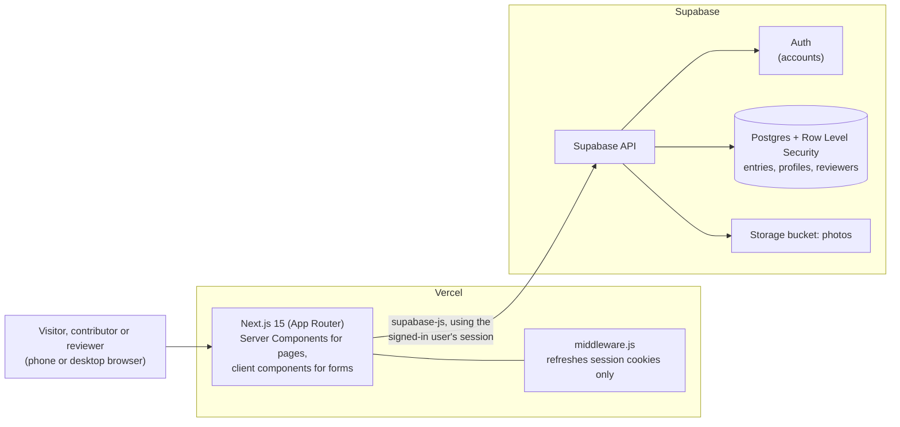
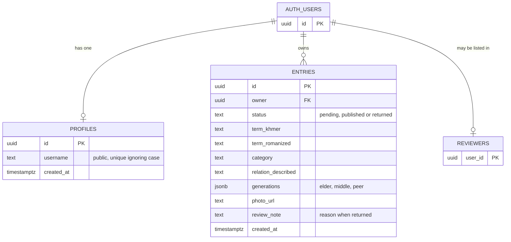
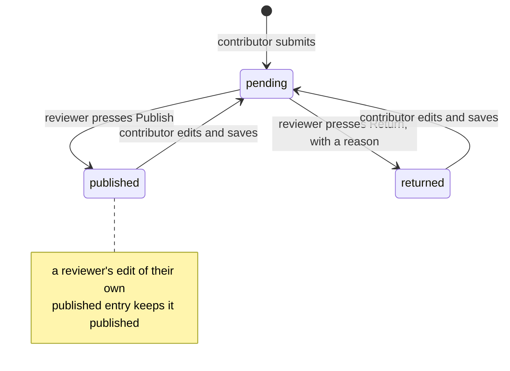
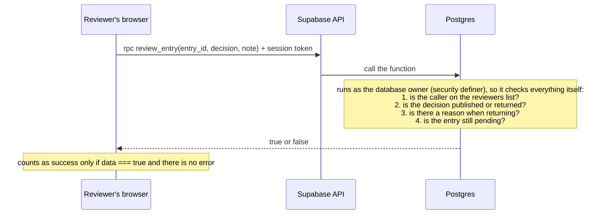

# Khmer Living Archive: Khmer Kinship Terms

A community archive of the words Khmer speakers use to address their relatives, shown across three generations.

- **Live site:** https://ict340-khmer-kinship-archive.vercel.app
- **Course:** ICT 340 Vibe Coding, AUPP (final capstone)
- **Curator:** Suos Sovanrith

---

## 1. What this is

This archive collects Khmer kinship terms: the different words people use to address and talk about their relatives, such as *Mak*, *Bong*, *Oun*, *Ta*, *Yay* and *Chao*. Each entry shows the word in Khmer script with a romanization, a plain-language description of the relation, and how the word is used across **three generations**: grandparent-age, parent-age and my own generation. Every generation records whether the word is still used the same way, has changed, has been replaced, or is no longer used.

The 11 published entries come from interviews on 2 September 2026 with three of my relatives (my grandmother, my mother and my older sister). A visitor can browse and search the published entries without an account. A signed-in contributor can add an entry with a photo; it waits for review, and I, as the reviewer, publish it or return it to the contributor with a reason.

## 2. Who it's for

The archive is for two groups of people in Cambodia: Cambodians who want to see how their family words are used across generations, and foreigners living in Cambodia who want to learn how Khmer people address their relatives.

What I did because of who the users are:

- **Bilingual, side by side, not a language switch.** English and Khmer appear together at the places people read and act: form labels, buttons, error and success messages, status words, the entry cards and the header. A person doesn't have to find a language setting, and both groups can use the same page. All of this text lives in one file, `lib/uiText.js`, so the Khmer can be checked in one place. Entries themselves are written in Khmer script with a romanization.
- **Phone and desktop.** Many people in Cambodia use a phone, and some don't have a computer, but many foreigners prefer a desktop. Entry cards show two per row on wide screens and one per row below 900 px. The header collapses into a menu on screens 1024 px wide or narrower. Photo uploads are limited to JPEG, PNG or WebP and 5 MB.
- **Photos show writing, not people.** The archive's photo policy is a photo of the written word, never an identifiable portrait (`entry-sketch.md`).
- **Sources are named, with permission.** Each generation's note is credited to the person it came from, with their relation and place. Contributors who are not the curator must name who told them (see Section 4), so one person's knowledge is never credited to someone else.
- **Showing it to my sources.** I showed the archive to the three relatives I interviewed. They were happy with it, and they said they felt honoured to see their own names in it.

## 3. How it works

The site is **Next.js 15 (App Router) with React 19, in JavaScript, deployed on Vercel**. **Supabase** provides accounts (Auth), the database (Postgres with Row Level Security) and photo storage (Storage). Two packages beyond Next and React are used: `@supabase/supabase-js` and `@supabase/ssr`.



`middleware.js` only refreshes the session cookie. It does not protect any route. Each server page guards itself (for example `redirect("/login")`), and the database enforces the real rules.

### Pages

| Route | What it does |
|---|---|
| `/` | Home: the collection, the curator and the source |
| `/entries` | Browse and search published entries, 6 per page (search runs over all published entries in the browser, then pages the result) |
| `/signup`, `/login` | Create an account with a public username; sign in |
| `/account` | Change my public username |
| `/contribute` | Add an entry with a photo (signed-in only) |
| `/entries/[id]/edit` | Edit my own entry (the server redirects anyone else) |
| `/my-entries` | My entries with their status in English and Khmer, and the reviewer's reason on returned ones, 10 per page |
| `/review` | Reviewer queue: status tabs with counts, oldest or newest first, Publish and Return, 5 per page. Reviewers only |

### Tables



- **`entries`**: one row per term. The three generations (`elder`, `middle`, `peer`) are stored in one `generations` JSON column, each with `still_used`, `note`, an optional `alternate_term` and an optional `source_override`. Other columns: the Khmer term, the romanization, one of five fixed categories, the relation description, tags, pronunciation, usage notes, variation, and the photo URL, caption and credit.
- **`profiles`**: one row per account, holding a **public** username. A database trigger creates it when someone signs up. The permanent identity of a contributor is the account id (`entries.owner`), never the name.
- **`reviewers`**: a list of account ids allowed to review. It can only be changed in the Supabase SQL Editor.

Photos: ten of the published entries (Mak, Bong, Oun, Ming, Pou, Om, Ta, Yay, Chao, Puk) use image files in `public/photos/`. Tuot's photo was added through the contribute form, so it lives in the Storage bucket `photos`, in a folder named after the uploader's account id. Photos added through the form go to that bucket, and the file extension comes from the file's type, never from its name.

### Entry statuses



### Policies: who can read and write what

Row Level Security is turned on for `entries`, `profiles` and `reviewers`.

| Table | Operation | Policy | Rule |
|---|---|---|---|
| `entries` | SELECT | anyone can read published entries | `status = 'published'`, or I am the owner, or I am a reviewer |
| `entries` | INSERT | owners add their own entries (signed-in) | `owner` is me **and** `status = 'pending'` |
| `entries` | UPDATE | owners edit their own entries (signed-in) | I own the row, and the new status is `pending` unless I am a reviewer |
| `entries` | DELETE | owners delete their own entries | I own the row (only signed-in users hold the DELETE privilege) |
| `profiles` | SELECT | everyone (including logged out) | names are public credit |
| `profiles` | UPDATE | only my own row | and only the `username` column is granted |
| `reviewers` | all | none | RLS on, no policies, and the API roles have no read or write privilege |
| Storage `photos` | INSERT | signed-in, into my own folder | folder name = my account id |
| Storage `photos` | DELETE | signed-in, my own folder only | |

Two behaviours worth knowing: a blocked `UPDATE` or `DELETE` on someone else's row quietly changes **0 rows** and returns no error, so the code always checks that a row came back. A blocked `INSERT` throws error `42501`.

### Functions and triggers

| Name | What it does |
|---|---|
| `is_reviewer()` | Returns true if the signed-in user is in `reviewers`. `security definer`, so it can read the closed table for me |
| `review_entry(entry_id, decision, note)` | The only door reviewers use. See Section 4 |
| `require_source_override()` (trigger on `entries`, before insert or update) | Refuses an entry from a non-reviewer unless all three generations name a source |
| `handle_new_user()` (trigger on `auth.users`) | Creates the profile row when someone signs up |
| `username_available(candidate)` | Lets the signup form check whether a username is free |

### Database constraints

`entries` has 15 CHECK constraints: trimmed length limits on every text column, `category` must be one of the five allowed strings, `status` must be `pending`, `published` or `returned`, and one constraint per generation checks its JSON (`still_used` in `Same`, `Changed`, `Replaced`, `Unused`; `note` 1 to 500 characters; `alternate_term` and `source_override` bounded). `profiles` has 8 CHECK constraints on the username (2 to 40 characters, trimmed, normalized, no control or invisible characters, no unusual spaces, no reserved names such as `admin`) and a unique index on the lower-cased username (`profiles_username_lower_idx`), so two accounts can't use the same name in different letter cases.

Validation is layered: JavaScript in the forms gives helpful messages, CHECK constraints and triggers hold the line if the form is bypassed, and RLS decides ownership.

All of the SQL (the tables, policies, constraints, functions and triggers from all three sprints) was run in the Supabase SQL Editor and is not kept as files in this repository. This section was written from a live query of the database on 20/11/2026, so it describes what is actually running.

## 4. Security decisions

### The gate

New entries start as `pending` and the public sees only `published` ones. The rule that nobody can publish their own entry is enforced **in the database**, in three places that work together:

1. The **INSERT policy** only accepts `status = 'pending'`, so a new row can't publish itself.
2. The **UPDATE policy** only lets a non-reviewer save an entry as `pending`, so an owner can't publish their own entry by editing it.
3. **`review_entry`** is the only way to move an entry to `published` or `returned`.



`review_entry` runs with the database's own permissions (`security definer`), so it can look at the closed `reviewers` table. That is exactly why it has to check everything itself. It returns `false`, without an error, when the caller isn't a reviewer, when the decision isn't `published` or `returned`, when a return has no reason of 1 to 500 characters, or when the entry is no longer `pending`. Reviewers are never given permission to edit other people's entries: they get one narrow door that moves a status and nothing else.

### What a hidden button does and doesn't protect

A hidden or missing Publish button is politeness. It keeps the page tidy, but anyone can call the database from the browser console. The same goes for the extra `status = 'published'` filter on the public pages and for the page-level reviewer check on `/review`. If every one of them were deleted, a stranger would still be refused, because the database says no. That's why the gate lives in the database, and why I tested it from the console as a stranger, and not only through the page.

Because `review_entry` refuses by returning `false` without an error, the Publish and Return buttons count a result as success only when `data === true` and there is no error. Anything else leaves the entry where it was and shows a failure message. The same code path handles two reviewers acting on the same entry in two tabs: the second one gets `false`.

### Other protections

- **The reviewers list is closed.** RLS is on with no policies, and the API roles have no read or write privilege on it. A stranger who tries to add themselves gets a permission error. Only I can edit the list, in the SQL Editor.
- **Ownership.** Contributors can edit and delete only their own entries (the policies above). The edit page also checks ownership on the server and redirects anyone else. The owner is always taken from the signed-in session at submit time, never from the form.
- **No secrets in the repo.** The site uses only the Supabase URL and the publishable key, which are public by design. No secret or service key exists in the code or the git history, and `.env*` is ignored.
- **Generic sign-in and sign-up errors** ("Invalid email or password"), so the site doesn't reveal which emails have accounts. A taken *username* does say "taken", because usernames are public anyway.

### Decisions the briefs left to me

- **A returned entry must carry a reason.** The reviewer can't return an entry without writing one (1 to 500 characters). The button checks it, and `review_entry` refuses it too. The contributor sees the reason on `/my-entries` while the entry is returned. A contributor who shared a family word shouldn't get "returned" with no explanation.
- **Strangers must name their source.** The card shows a source for each generation, and without one it falls back to my standing interview sources, which would credit my grandmother by name for knowledge she never gave. So anyone who isn't a reviewer must fill "who told you this" for all three generations, enforced by the `require_source_override` trigger and not just the form. They can write "Anonymous". My own entries may keep using the standing sources.
- **Editing sends an entry back to review.** An edit by a contributor puts a published, pending or returned entry back to `pending`. A reviewer's edit keeps their own *published* entry published, but a reviewer's edit of a *returned* entry also goes back to `pending` (my review partner found that bug, see Section 5).
- **The reviewer sees the real card.** The queue shows each entry exactly as the public will see it, with the submission date and the contributor's username and the start of their account id (a username can be changed, the id can't).
- **Search shows published entries only, even to the owner.** A contributor's own pending entries appear on `/my-entries`, not in browse or search, so the public pages look the same to everyone.
- **Reviewers cannot take down a published entry from the page.** This needs one more database function, so I didn't build it. If a published entry is wrong, I can fix it in the SQL Editor, and the contributor's own edit sends it back to review.
- **The photo is required when adding an entry and optional when editing**, and the policy is a photo of the written word, never a portrait.

### Known limits

- The photo bucket checks the declared file type but not the file's contents, deleting an entry leaves its photo behind, and the bucket has no SELECT policy so cleanup from the app silently does nothing. Fixing it means a server-side upload route that checks the file's first bytes, plus cleanup on delete.
- Owners can edit their own `review_note` through the console. Nobody else sees it, and it is only shown while an entry is `returned`, which only a reviewer can set.
- Supabase's default grants give the signed-in and anonymous roles privileges such as `TRUNCATE` on the tables. RLS does not apply to them, but the REST API has no endpoint that uses them.
- The database SQL lives only in my Supabase SQL Editor, not in the repo, so the schema is documented here but can't be rebuilt from a file. Fixing it means exporting the schema into versioned SQL files.
- There is one reviewer, listed only in SQL, and no email notifications. The browse page downloads all published entries and searches and pages them in the browser, which is fine at this size but wouldn't be at hundreds. Usernames can imitate each other with look-alike letters.
- Search assumes one Latin spelling per Khmer word. Four terms from my interviews (Kmek, Khmoay, Pdei, Propun) were sketched but not added, because their sources disagree or I hadn't verified them.

**Attack testing.** I tested the gate as a stranger from the browser console, with a control on every attack so a refusal couldn't be mistaken for a broken test: insert as published, update my own entry to published, call `review_entry` on my own and on someone else's entry, insert myself into `reviewers`, read unpublished entries while logged out, edit and delete another user's entry, and insert or edit without a source. Every attack was refused. Dates: 20/11/2026.

## 5. AI use
 
I used AI heavily in this project. This section says exactly what it did, what I did myself, how I directed it, and how I checked it, so that nothing here is a surprise. It replaces the Prompt Journal for the final. Some commits aren’t as marked AI-Assisted because most are minor changes, data, and photo updates I made by hand and a few early Sprint 1 commits had AI help before I settled the habit of marking, and I did not rewrite history.
 
### 5.1 The rules I set for the AI
 
- **`AGENTS.md`** (provided by the course, amended once by me for the sign-in packages): exactly two extra packages (`@supabase/supabase-js` and `@supabase/ssr`), no keys or tokens ever written into files, and never invent interview or source data.
- **Plan first** for any change touching more than one file. I read and approved the plan before any code was written.
- **Every prompt named the exact files it could touch** and said what it must not touch (SQL, policies, packages). I embedded literal values, such as exact Khmer strings and class names, instead of saying "go read the docs".
- **One task per session.** If a prompt used "and" more than twice, I split it.
- **Every commit with AI help ends `[AI-Assisted]`**.
### 5.2 Models
 
| Model | Where | Tasks | Verdict |
|---|---|---|---|
| `z-ai/glm-5.2:free` | Cline, Plan mode | Early Sprint 1: the implementation plan and how to use the mock data | Kept nearly all of it. Would use again |
| `nvidia/nemotron-3-super-120b-a12b:free` | Cline, Act mode | Early Sprint 1: the first components and a review-and-fix pass | Rewrote what got flagged, left the rest. Would use again |
| `deepseek/deepseek-v4-flash-0731` | Cline, Plan and Act | Late Sprint 1 to the final: most of the application code (Supabase queries, forms, edit and delete, the review queue, pagination, the header menu, the bilingual wiring) | Kept most after reading each diff, and sent back changes that touched files I hadn't named. I switched to this to use a paid model instead of the free one for a stronger but also cleap model.|
| Claude Sonnet 5 and 5.5 (Anthropic) | claude.ai chat | Wrote the prompts for Cline, wrote and tested SQL on a throwaway local Postgres, reviewed diffs, drafted the Khmer interface text, wrote the pagination helpers and component, drafted this README | Used as planner, tester and reviewer. I ran everything myself, and nothing it wrote touched my database before it was tested |
 
### 5.3 What the AI wrote, and what I did
 
| Area | Who wrote it | What I did | How I checked it |
|---|---|---|---|
| **The collection itself**: all entry content, the Khmer terms, the generation notes, the sources and the photo credits | **Me**, from my interviews on 2 Sept 2026 | The AI never wrote or invented entry content. Four terms I couldn't verify (Kmek, Khmoay, Pdei, Propun) were not added | Compared against my interview notes |
| Browse, entry cards and search (Sprint 1) | The three Cline models above | Kept the plan, rewrote flagged parts, chose how the three generations are shown | Read the diffs, ran it locally, searched in Khmer and in English |
| Accounts, contribute form, edit and delete (Sprint 2) | `deepseek` in Cline, from prompts written with Claude | Chose that the photo is required on create and optional on edit | Fresh clone and `next build`, then a two-account attack: another user's edit and delete returned 0 rows |
| Tables, constraints, profiles and usernames (Sprint 2) | SQL written with Claude | Ran it only after it passed accept and reject cases on a throwaway Postgres | Console attacks from the browser, each with a control |
| The review gate: `status`, `reviewers`, `is_reviewer`, `review_entry`, the policies (Sprint 3) | My professor's lab SQL | Ran it as written, did not write it | 5 console attacks as a stranger |
| The reviewer's reason (`review_note`, the new `review_entry`) and the required-source trigger | SQL written with Claude | Decided both rules and approved the design | 21 and about 25 accept/reject cases on a throwaway Postgres, then console attacks on the live site |
| Submit, edit, My entries, the review queue, tabs, sort | `deepseek` in Cline, from prompts written with Claude | Plan first, then read every diff | Fresh clone and build, grep for direct table updates, the full round trip, stranger attacks |
| Bilingual English and Khmer text | Claude drafted the Khmer, Cline wired it in | I am a Khmer speaker and reviewed every string. I rewrote 7 of the first batch of field labels myself and approved the rest after reading | Searched the files for the exact strings, scanned for English I'd missed |
| Header menu, pagination, layout polish | `deepseek` in Cline. Claude wrote the pagination helpers and component | Chose the breakpoints (900 px for the cards, 1024 px for the header) | Tested at phone and desktop widths in the browser |
| **This README** | Claude drafted it from the repo and a live query of my database | I checked every claim against the code and the database, and wrote the sections about my sources and my decisions | Spot-checked each statement in the repo |
| **Every decision**: what to build, what to refuse, what a returned entry says, the rule that strangers must name a source | **Me** | | |
 
### 5.4 How I directed the AI
 
I used these techniques deliberately:
 
- **Step by step, plan first.** For anything across several files, Cline gave a plan and I reviewed it before it wrote code.
- **Contextual prompting with stated constraints.** Each prompt listed the files it could change and what it must never do. For the review buttons, for example: *"NEVER call supabase.from("entries").update(...)"* and *"SUCCESS means exactly `data === true && !error`."*
- **Literal values.** I pasted the exact Khmer text and style values, so the AI could not reword them. I then searched the files to confirm they were unchanged.
- **Splitting and firming up** when the AI did not comply: I asked for a diagnosis first with no changes, then wrote a stricter prompt.
- **A strict-reviewer prompt** after every diff: *which files did it touch that I didn't authorize, did it invent a value, did it add a dependency?*
### 5.5 How I checked the AI's work
 
- Read every diff before pushing.
- Cloned the pushed repo fresh and ran `next build`, so I wasn't trusting my own machine.
- Searched the code for risky patterns: direct `.update(` or `.delete(` calls in the review code, `dangerouslySetInnerHTML`, new packages, English text left behind.
- Tested SQL on a throwaway local Postgres before it touched my database: 21 cases for `review_entry` and about 25 for the required-source rule, covering strangers, reviewers, whitespace-only values, wrong types and my own maintenance.
- Attacked the live site from a second "stranger" account in the browser console, with a **control on every attack** so a refusal could not be mistaken for a broken test.
- Had my review partner try to break it with the course checklist.
### 5.6 Where the AI got it wrong, and how I caught it
 
| What went wrong | Where | How I caught it | What I did |
|---|---|---|---|
| The plan for `/review` added a footer I never asked for, hard-coded in English, and its self-audit marked every check as passing | Cline | Read the plan before approving it | Had it removed, and confirmed the real code myself |
| A reviewer editing their own *returned* entry left it stuck, because the rule "unless the editor is a reviewer" was implemented literally | Cline, from the lab's rule | **My review partner**, not me | Limited the reviewer exception to entries that are currently published |
| The header menu lost the space after the "·" before the Khmer text. The first diagnosis and first fix did nothing | Cline | Tested each fix in the browser | The real cause was `display: flex` splitting the label into items that each lost their edge spaces |
| The same space bug in the pagination buttons | Claude | Tested in the browser | Wrapped the label in a single element |
| Strings missed when making the site bilingual (signup labels, the search box, a few card labels) | Claude's prompts and my review | Scanned the code for English afterwards | Added them in a second round |
| A follow-up header prompt changed a file I hadn't named (`ContributeLink.js`) | Cline | Read the diff | Accepted it because I had asked for the header change, and noted it |
| The review cards showed labels stacked, because the CSS lived inside `EntryList.js`, which only the browse page uses | Cline | Looking at the page | Moved the CSS into the card itself |
| A test script I was given copied a real entry (Mak) into a pending duplicate | Claude | Looked at the data | Deleted it, and never published it |
| A relative import path copied from a nearby file broke `/contribute` | Cline | A fresh `next build` | Fixed the path, and made a fresh build part of my routine |
| Generated INSERT statements copied duplicate photos and a wrong caption faithfully from my own data | Cline | Parsed the SQL with a real parser with Claude Sonnet 5.5| Fixed the data |
 
 
### 5.7 Limits
 
- The project has no automated test suite. My verification is manual: reading diffs, building, local SQL tests and console attacks.

## 6. Sources and credits

**Interviewed sources** (interviews on 2 September 2026; all three agreed to be named):

| Person | Relation to me | Place | Generation in the archive |
|---|---|---|---|
| Chea Channy | My grandmother | Battambang | Grandparent-age |
| Chea Sotheavy | My mother | Kampong Chhnang | Parent-age |
| Suos Sopheasur | My older sister | Phnom Penh | My generation |

**Photos.** The photos of the written words on the 11 published entries are credited on each card to ភិក្ខុ ថេរានុរក្ខិតោ ថាច់ សើង, a Buddhist monk, author, and compiler known for his work in preserving Khmer calligraphy and Buddhist literature. His work are for public to access and use, and I used them by cropping individual letter and vowel and put them together to form a full khmer word, then credited him by full name.

**Contributors.** Entries added by other people are credited by their public username on the card, and each generation shows the source the contributor named. 

**Tools and fonts.** Khmer text uses the Noto Serif Khmer font from Google Fonts. Next.js, React and Supabase are open-source and hosted services used under their terms.

## 7. Running it locally

You need Node.js 18.18 or newer (the Next.js 15 requirement) and a Supabase project.

```bash
git clone https://github.com/SuosSovanrith/ict340-khmer-kinship-archive.git
cd ict340-khmer-kinship-archive
npm install
```

Create a file named `.env.local` in the project root with these two variable **names** (take the values from your Supabase project's API settings):

```
NEXT_PUBLIC_SUPABASE_URL=<your project URL>
NEXT_PUBLIC_SUPABASE_PUBLISHABLE_KEY=<your publishable key>
```

Then:

```bash
npm run dev      # http://localhost:3000
npm run build    # production build
```

The publishable key and project URL are public by design: they are sent to every visitor's browser, and the database's Row Level Security decides what that key can do. No secret or service key is used anywhere, and `.env*` files are git-ignored. After changing either value, redeploy, because `NEXT_PUBLIC_` values are inlined at build time.

A fresh Supabase project also needs the tables, policies, functions and triggers described in Section 3. They are not kept as SQL files in this repo, so you would recreate them from that section.

## 8. Submission checklist

- Live URL loads logged out and shows published entries only: yes, https://ict340-khmer-kinship-archive.vercel.app
- A stranger cannot publish their own entry through the page or the console: yes, tested 20/11/2026 (Section 4; policies `owners add their own entries` and `owners edit their own entries`, function `review_entry`)
- Logged out, the API returns nothing pending or returned: yes, tested 20/11/2026 (policy `anyone can read published entries`)
- Contributors can edit and delete only their own entries: yes, tested 20/11/2026 (policies on `entries`; `app/entries/[id]/edit/page.js`)
- No secrets anywhere in the repo history: yes, checked with `git grep` across every commit for secret keys, JWTs, tokens, private keys and email addresses on 20/11/2026
- At least eight real entries, each with a credited source: yes, 11
- Khmer renders on every screen a user meets, including the queue: yes (`lib/uiText.js`, `components/Bi.js`)
- Works at phone width: yes, tested on 360px
- No test entries, lorem ipsum or TODO comments in shipped pages: yes
- No console errors on the main pages: yes, checked on 20/11/2026
- jesseorndorff is a collaborator on this repo: yes
- Supabase project restored and awake on 20/11/2026
- Demo video link opens in a private window: yes, [LINK]
- Reflection pasted in the Canvas submission: yes
- Posted in the Show Your Archive discussion: yes
- Q&A slot booked for 01/Dec/2026 15:10 - 15:15